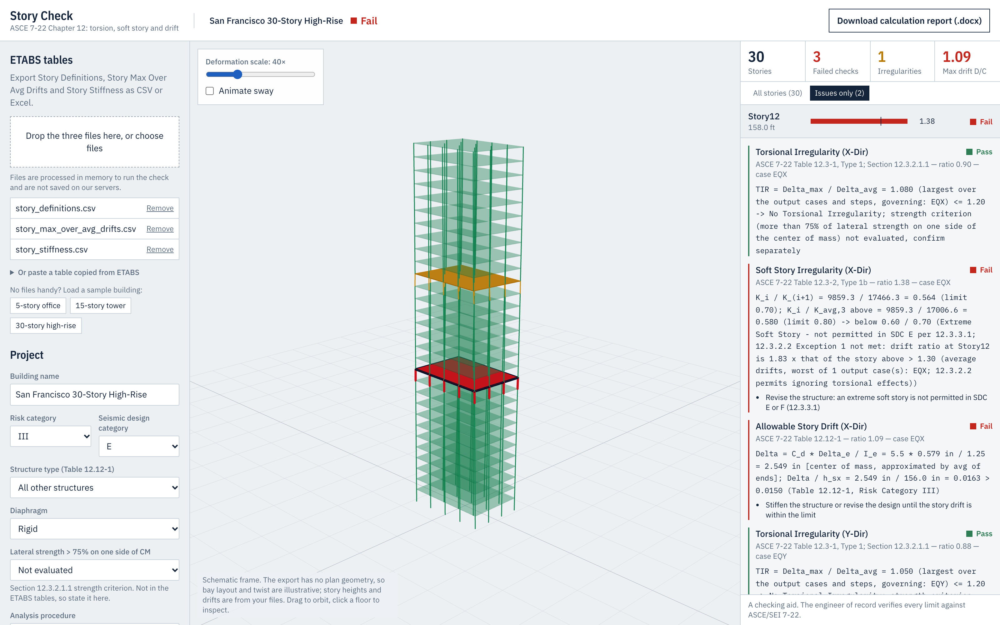
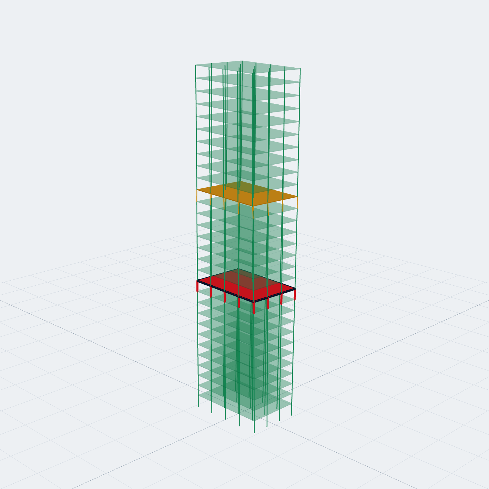
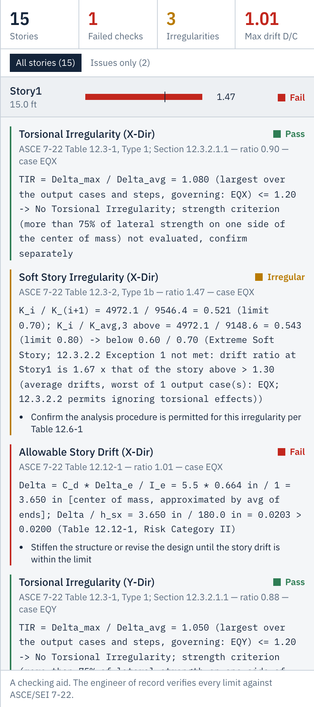

# Story Check

Seismic irregularity and story drift checks for ETABS models, per ASCE/SEI 7-22 Chapter 12.

Upload three tables exported from ETABS. Story Check flags torsional irregularity, soft stories and story drift exceedances, shows the result on a 3D story model, and writes a Word calculation report with every formula, code reference and output case.

**Live demo:** https://story-check-virid.vercel.app. A 15-story sample building loads right away. The API runs on a free tier that sleeps when idle, so the first check can take about a minute.



> Story Check is a checking aid. It does not replace the judgment of the engineer of record, and its limits and code references have not yet been verified line by line against the published ASCE 7-22 text. See [Limitations](#limitations).

## What it checks

| Check | Reference | Result |
| :--- | :--- | :--- |
| Torsional irregularity | Table 12.3-1 Type 1, Torsional Irregularity Ratio (TIR) per §12.3.2.1.1 | Irregular when TIR > 1.2, or when the engineer marks the 75% lateral-strength criterion. Lists the follow-up requirements for the SDC (A_x per §12.8.4.3, +25% forces per §12.3.3.5, ρ = 1.3 when TIR > 1.4, and so on). |
| Soft story | Table 12.3-2 Types 1a and 1b, with the §12.3.2.2 exceptions | Type 1b is FAIL in SDC E and F (§12.3.3.1), otherwise WARNING. |
| Allowable story drift | §12.12.1, Table 12.12-1, amplified per §12.8.6 | Edge drift is used where the story is torsionally irregular in SDC C to F. |

Each check returns `PASS`, `WARNING` (irregular but permitted, with required actions), `FAIL`, or `N/A` with the reason. With several output cases, each story uses its governing case, and the case is recorded on every check.

<p>
  
  
</p>

## Exporting from ETABS

After running the analysis, open **Display → Show Tables** (Ctrl+T) and export these three tables to Excel or CSV:

| Table | Where in ETABS | Used for |
| :--- | :--- | :--- |
| Story Definitions | Model → Building Data | Story names and heights |
| Story Max Over Avg Drifts | Analysis Results → Displacements | Torsion and drift checks |
| Story Stiffness | Analysis Results → Structure Results | Soft story check |

Select all seismic output cases (EQX, EQY, the accidental-eccentricity cases, response spectrum cases). The tables can be separate files, sheets of one workbook, or pasted straight from the ETABS table grid into the website. Then enter what the tables don't carry: risk category, SDC, C_d, structure type and diaphragm type.

Menu paths can differ between ETABS versions. The parser has so far been tested on generated sample files only. Real ETABS exports are welcome as issues.

## Running locally

Requires Python 3.10+ and Node 20+.

```bash
python3 -m venv .venv
.venv/bin/pip install -r requirements.txt
.venv/bin/python -m pytest -q
.venv/bin/python -m uvicorn backend.main:app --port 8000
```

```bash
npm --prefix frontend install
npm --prefix frontend run dev        # http://localhost:3000
```

The frontend reads the API address from `NEXT_PUBLIC_API_URL` and defaults to `http://localhost:8000`.

### API

```bash
D=data/15_story_tower
curl -X POST localhost:8000/api/analyze \
  -F files=@$D/story_definitions.csv \
  -F files=@$D/story_max_over_avg_drifts.csv \
  -F files=@$D/story_stiffness.csv \
  -F "project_info=<$D/project.json" -o result.json

curl -X POST localhost:8000/api/export-report \
  -H 'Content-Type: application/json' -d @result.json -o report.docx
```

| Endpoint | Input | Output |
| :--- | :--- | :--- |
| `POST /api/analyze` | multipart: `files` (the tables), `project_info` (JSON), optional `length_unit`, `force_unit`, `case_x`, `case_y` | Check results, the resolved design basis, and input file hashes |
| `POST /api/export-report` | JSON: the `/api/analyze` response | `.docx` calculation report |
| `GET /api/health` | none | `{"status": "ok"}` |

Invalid input returns HTTP 422 with a message meant for the user, including unknown `project_info` fields. The data contract is described in [docs/structural_code_check_copilot_blueprint.md](docs/structural_code_check_copilot_blueprint.md).

### Sample data

`python -m backend.mock_data_gen` regenerates three synthetic buildings (5, 15 and 30 stories) in `data/` and the precomputed results the website shows on first load in `frontend/public/samples/`.

## Project structure

```
backend/
  parser.py           ETABS CSV / Excel / pasted-text parsing, output case selection
  code_checker.py     ASCE 7-22 check engine (pure functions, no I/O)
  report_builder.py   Word calculation report
  main.py             FastAPI routes
  mock_data_gen.py    synthetic sample buildings
frontend/             Next.js 16, React 19, Tailwind 4, three.js
tests/                engine, parser, API and report tests
data/                 sample buildings
docs/                 design notes, change log and review reports
render.yaml           backend deployment (Render)
```

The frontend deploys to Vercel with `frontend` as the root directory. The backend deploys to Render from `render.yaml`. Set `CORS_ORIGINS` on the backend to the frontend URL.

## Limitations

- Code limits and section numbers come from secondary sources and have not been checked line by line against the published ASCE 7-22. A few action items (ρ = 1.3 in one or both directions, §12.5 orthogonal combination) are worded as "confirm" for that reason.
- Drift at the center of mass is approximated by the average of the two story ends. This can be unconservative when the center of mass is far from the geometric center.
- The value of A_x, weak story, P-delta stability and diaphragm flexibility are not computed.
- The 3D view is schematic. ETABS story tables carry no plan geometry, so bay layout and twist are illustrative.
- Uploaded files are processed in memory and not stored.

## How it was reviewed

The engine went through two rounds of review by three AI models. The first round found that the torsion check followed the ASCE 7-16 framework while being labeled 7-22. The second round found a case-selection bug that could report an exceeding drift as passing. Both are fixed and covered by tests. The reports, and how each finding was handled, are in [docs/reviews](docs/reviews/) and section 12 of [docs/PROJECT_REVIEW.md](docs/PROJECT_REVIEW.md) (in Traditional Chinese).

## License

[MIT](LICENSE)
